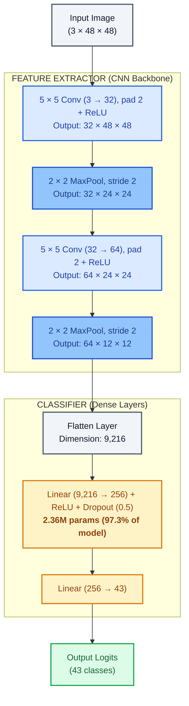
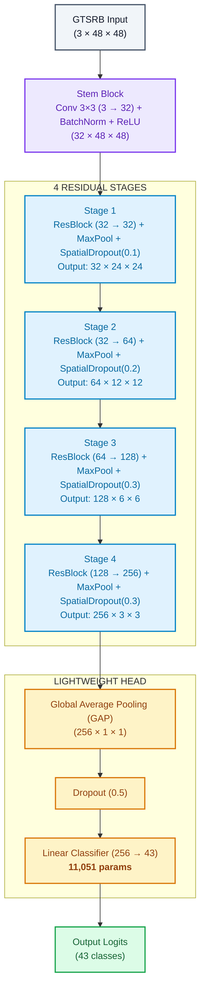
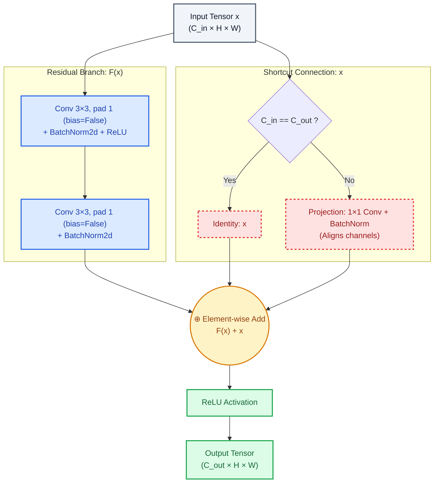
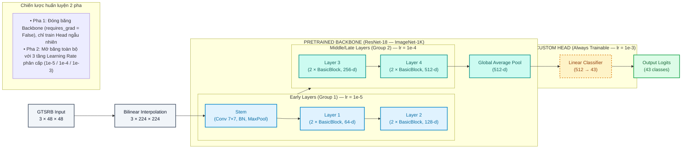

# GTSRB — So sánh 3 hướng tiếp cận Deep Learning phân loại 43 lớp biển báo giao thông

Dự án nghiên cứu và thực nghiệm so sánh 3 triết lý thiết kế mô hình Deep Learning trên tập dữ liệu **German Traffic Sign Recognition Benchmark (GTSRB)** gồm **51.839 ảnh** thuộc **43 lớp**:
1. **M1 (Baseline):** Mạng CNN cổ điển xây từ số 0 theo phong cách LeNet-5.
2. **M2 (Modern Custom CNN):** Mạng CNN sâu tự thiết kế (VGG-Res) kết hợp BatchNorm, Residual Shortcut, Spatial Dropout và Global Average Pooling (GAP).
3. **M3 (Transfer Learning):** Tận dụng các Backbone tiền huấn luyện trên ImageNet-1K (ResNet-18, MobileNetV2, EfficientNet-B0) với kỹ thuật Fine-tuning 2 pha và Discriminative Learning Rates.

---

## Bảng so sánh kết quả chính (Tập Test chính thức: 12.630 ảnh)

Mọi số liệu được đo lường đồng bộ trên cùng tập kiểm thử chính thức không rò rỉ:

| Mô hình | Hướng tiếp cận | Tham số | FLOPs | Top-1 | **Macro-F1** | ECE | Latency p50 (CPU) |
| :--- | :--- | :---: | :---: | :---: | :---: | :---: | :---: |
| **M1 LeNet** | Baseline CNN từ số 0 | 2,42 M | **0,07 G** | 98,46% | **0,9778** | 0,1310 | **0,9 ms** |
| **M2 VGG-Res** *(Tự thiết kế)* | Deep CNN + Residual + GAP | **1,24 M** | 0,29 G | 99,26% | **0,9880** | **0,0535** | **3,2 ms** |
| **M3 ResNet-18** | Pretrained Residual Backbone | 11,20 M | 3,65 G | **99,33%** | **0,9903** | 0,1085 | 16,7 ms |
| **M3 EfficientNet-B0** | Pretrained Compound Scaling | 4,06 M | 0,83 G | 98,76% | **0,9838** | 0,0973 | 243,4 ms |
| **M3 MobileNetV2** | Pretrained Inverted Residual | 2,28 M | 0,65 G | 98,73% | **0,9796** | 0,1076 | 47,9 ms |

> 📌 **Lưu ý cốt lõi:**
> - **Macro-F1 là chỉ số quyết định:** Do tập dữ liệu mất cân bằng nghiêm trọng (10,7 : 1), Top-1 Accuracy có thể che giấu sai sót ở các lớp thiểu số (lớp 0 chỉ có 60 ảnh test; đoán sai toàn bộ lớp 0 chỉ giảm 0,48% Accuracy nhưng làm mất 2,33% Macro-F1).
> - **Kiểm định McNemar:** $M2$ đánh bại vượt trội $M3\text{ (EffNet-B0)}$ ($p = 6,3 \times 10^{-7}$) và $M3\text{ (MobileNetV2)}$ ($p = 3,9 \times 10^{-7}$). Giữa $M2$ và $M3\text{ (ResNet-18)}$ không có sự khác biệt mang ý nghĩa thống kê ($p = 0,4477$), dù $M2$ có kích thước nhỏ hơn **9 lần** và nhanh hơn **5 lần**.

---

## Cấu trúc dự án

Dự án được tái cấu trúc theo nguyên tắc **tối giản, minh bạch và tự chứa (self-contained)**. Mỗi file mô hình chứa trọn vẹn từ định nghĩa kiến trúc đến pipeline huấn luyện:

```text
gtsrb-model-comparison/
├── preprocess.py        # Tải GTSRB, chia train/val THEO TRACK, cache ảnh CLAHE 48x48 (.npy)
├── common.py            # Thành phần dùng chung: Dataset, DataLoader mmap, Macro-F1, McNemar
├── train_m1.py          # M1 LeNet: Baseline CNN tự chứa
├── train_m2.py          # M2 VGG-Res: CNN hiện đại tự thiết kế
├── train_m3.py          # M3 Transfer: Fine-tuning ResNet-18 / MobileNetV2 / EfficientNet-B0
├── evaluate.py          # Nạp checkpoint đã huấn luyện, in bảng so sánh, McNemar & Latency
├── notebooks/           # Notebooks phục vụ EDA và huấn luyện tương tác (Google Colab)
├── data/                # data/raw/ và data/processed/ (chạy preprocess.py để sinh)
├── checkpoints/         # Lưu trọng số mô hình tốt nhất (.pt)
└── results/             # Báo cáo chi tiết (BAO_CAO.md, LY_THUYET.md, KET_QUA.md, figures/)
```

---

## Kiến trúc chi tiết các mô hình

### 1. M1 LeNet — Baseline CNN

M1 mô phỏng kiến trúc LeNet-5 cổ điển nhằm tạo mốc tham chiếu kỹ thuật (không dùng BatchNorm, không Residual, không Dropout kênh không gian).



* **Điểm nghẽn kiến trúc:** M1 dồn tới **97,3% tham số** vào duy nhất lớp kết nối đầy đủ đầu tiên (`Flatten 9216 → FC 256`). Điều này làm lãng phí dung lượng bộ nhớ mà không tăng cường khả năng trích xuất đặc trưng không gian.

---

### 2. M2 VGG-Res — CNN hiện đại tự thiết kế

M2 giải quyết triệt để điểm yếu của M1 thông qua 5 cải tiến:
1. **Thay Conv 5×5 bằng hai Conv 3×3 liên tiếp:** Cùng trường tiếp nhận (receptive field) nhưng giảm 28% tham số và tăng tính phi tuyến.
2. **Batch Normalization trước ReLU:** Ổn định phân phối gradient, cho phép hội tụ nhanh hơn.
3. **Residual Shortcuts ($y = F(x) + x$):** Tránh hiện tượng suy thoái (degradation), tạo "đường cao tốc" bảo toàn gradient.
4. **Spatial Dropout (`Dropout2d`):** Triệt tiêu ngẫu nhiên toàn bộ kênh đặc trưng thay vì từng pixel rời rạc.
5. **Global Average Pooling (GAP):** Thay thế hoàn toàn cụm `Flatten + Dense`, cắt giảm tham số tầng phân loại từ 2.359.552 xuống chỉ còn **11.051** (giảm hơn 214 lần).

#### Tổng thể toàn mạng M2:


#### Vi cấu trúc khối `ResidualBlock`:


---

### 3. M3 Transfer Learning — Fine-Tuning với Discriminative LR

M3 tận dụng tri thức từ tập dữ liệu lớn ImageNet-1K. Dưới đây là kiến trúc pipeline huấn luyện cho ResNet-18:



> **Ghi chú về các Backbone khác trong M3:**
> - Đối với **MobileNetV2** và **EfficientNet-B0**, đầu ra của trích xuất đặc trưng có kích thước **1280 chiều**, và phần Classifier Head được thay thế bằng cụm `nn.Sequential(Dropout(0.2), Linear(1280, 43))`.
> - **Lý do Upsample $48 \rightarrow 224$:** Backbone tiền huấn luyện thực hiện downsampling tổng cộng 32 lần ($2^5$). Nếu giữ nguyên ảnh gốc $48\times48$, kích thước đặc trưng ở tầng cuối cùng sẽ bị co cụm về $1\times1$ hoặc $2\times2$, làm triệt tiêu các đặc trưng không gian. Việc nội suy bilinear lên 224 giúp giữ feature map ở mức $7\times7$ chuẩn theo cấu hình pretrain.

---

## Các điểm kỹ thuật cốt lõi về Dữ liệu

1. **Phân chia dữ liệu theo Track (Group Split):**
   - GTSRB quay mỗi biển báo vật lý thành một track gồm 30 frame liên tiếp ở cự ly khác nhau.
   - Nếu chia ngẫu nhiên (random split), các frame trong cùng một track sẽ rơi vào cả tập Train và Val, dẫn tới hiện tượng **rò rỉ dữ liệu (data leakage)** nghiêm trọng (cho ra kết quả ảo tưởng ~99,8% trên Val).
   - Dự án thực hiện phân cụm theo `(ClassId, TrackId)` bằng `StratifiedGroupKFold`: số track dùng chung giữa train và val được bảo đảm bằng **0**.
2. **Nguyên tắc Data Augmentation an toàn:**
   - **Tuyệt đối không lật ngang (Horizontal Flip):** GTSRB có 4 cặp lớp đối xứng gương (19↔20: đường hẹp bên trái/phải; 33↔34: rẽ phải/trái; 36↔37; 38↔39). Lật ngang sẽ tạo ra dữ liệu mang nhãn sai hoàn toàn.
   - **Bảo toàn màu sắc:** Màu sắc biển báo mang thông tin ngữ nghĩa quyết định (Đỏ = Cấm, Xanh = Chỉ dẫn), không áp dụng ColorJitter làm biến đổi phổ màu cơ bản.
3. **Tối ưu hóa I/O với Binary Cache (`.npy` mmap):**
   - Toàn bộ ảnh sau khi áp dụng CLAHE và resize được nạp vào cache mmap. Giúp DataLoader của PyTorch chia sẻ page cache trực tiếp với nhân hệ điều hành, triệt tiêu nghẽn cổ chai đọc đĩa trong quá trình huấn luyện.

---

## Hướng dẫn cài đặt và sử dụng

### 1. Cài đặt môi trường

```bash
# Clone dự án và cài đặt dependencies
pip install -r requirements.txt
```

### 2. Chuẩn bị dữ liệu

Tải dataset GTSRB chính thức, áp dụng tiền xử lý CLAHE, cắt viền ROI, chia track và tạo cache nhị phân:

```bash
python preprocess.py --download
```

### 3. Huấn luyện mô hình

```bash
# Huấn luyện M1 LeNet (~12 phút)
python train_m1.py

# Huấn luyện M2 VGG-Res (~24 phút)
python train_m2.py

# Huấn luyện M3 Transfer Learning (lựa chọn backbone)
python train_m3.py --backbone resnet18
python train_m3.py --backbone mobilenetv2
python train_m3.py --backbone effnetb0
```

### 4. Đánh giá và so sánh kết quả

Nạp trực tiếp các checkpoint đã lưu trong thư mục `checkpoints/` để xuất bảng so sánh, kiểm định McNemar và đo độ trễ suy luận thực tế:

```bash
python evaluate.py
```

---

## Ba phát hiện thực nghiệm quan trọng

1. **Mô hình tự thiết kế 1,24 M tham số (M2) vượt trội hoặc tương đương các backbone ImageNet hàng chục triệu tham số:** Do ảnh biển báo giao thông gốc có độ phân giải thực tế thấp (trung vị $43\times43$), việc phóng to lên 224 không tạo thêm thông tin mới. Một kiến trúc tùy chỉnh gọn nhẹ với inductive bias phù hợp giải quyết bài toán hiệu quả hơn một mô hình khổng lồ.
2. **FLOPs không tỷ lệ thuận với Độ trễ suy luận (Latency):** EfficientNet-B0 có số phép tính FLOPs thấp hơn ResNet-18 tới 4,4 lần ($0,83\text{ G}$ vs $3,65\text{ G}$), nhưng trên thực tế đo đạc CPU lại chậm hơn **gấp 14 lần** ($243,4\text{ ms}$ vs $16,7\text{ ms}$). Nguyên nhân đến từ các thao tác Depthwise Conv và Squeeze-and-Excitation phân mảnh bộ nhớ và khó tối ưu hóa vector hóa lệnh song song.
3. **Độ chính xác cao nhất không đồng nghĩa với Độ bền vững (Robustness) cao nhất:** Khi thử nghiệm dưới 5 dạng nhiễu thực tế (sương mù, ánh sáng yếu, nhiễu cảm biến, che khuất), mô hình baseline M1 lại thể hiện sai số tương đối (mCE) ổn định hơn nhờ không bị overfit vào các tương quan đặc trưng phức tạp.